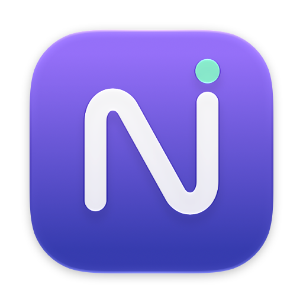
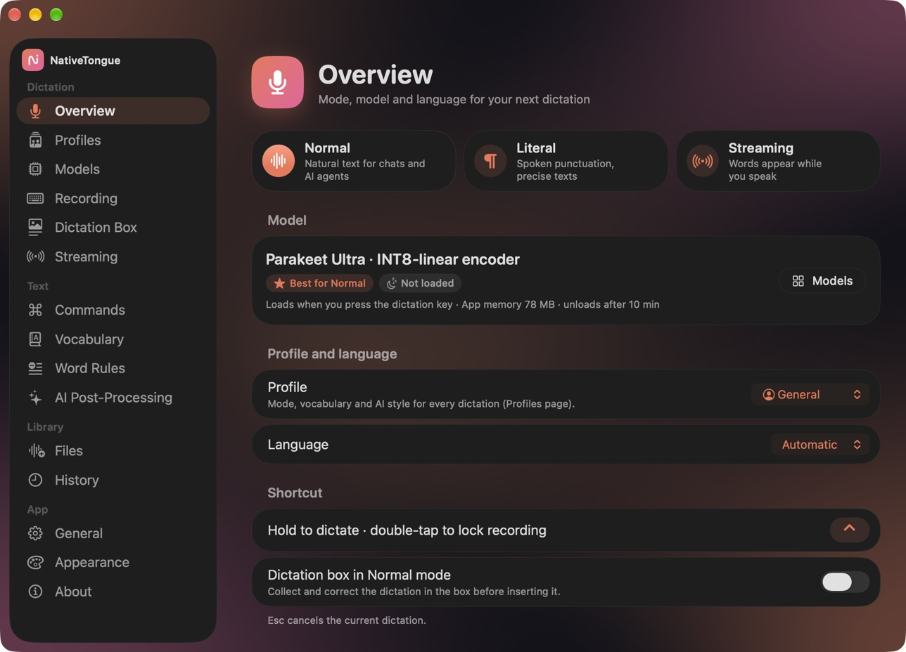
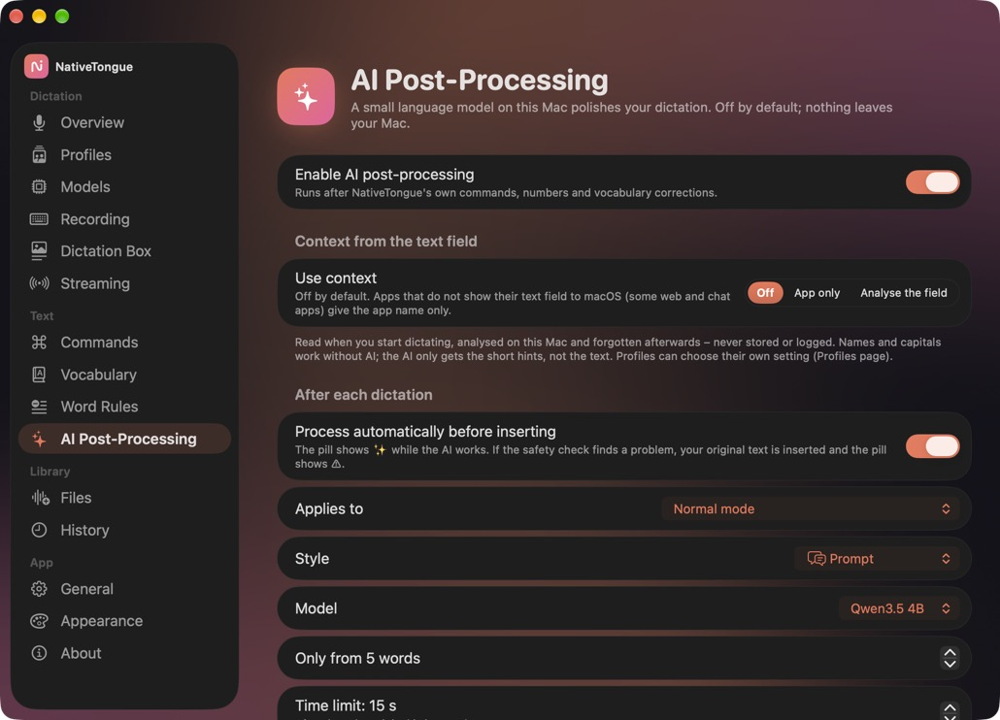
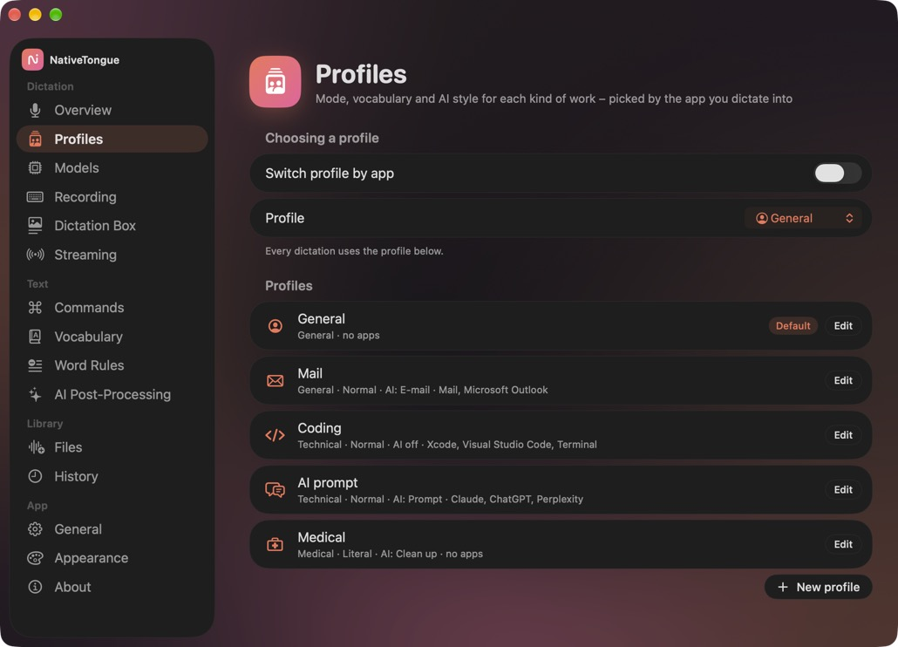
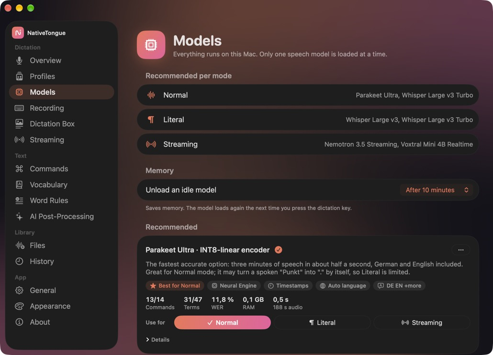
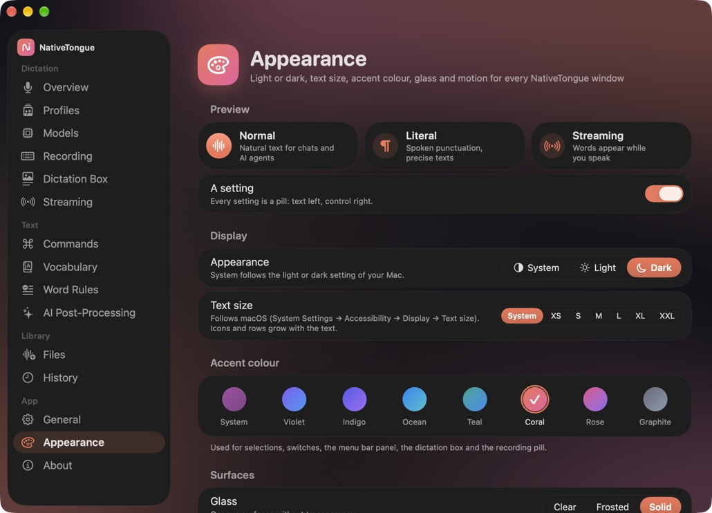

<p align="center">
  
</p>

<h1 align="center">NativeTongue</h1>

<p align="center">
  <strong>Private dictation for macOS. Your voice never leaves your Mac.</strong><br>
  German and English · spoken commands · local AI clean-up · file transcription
</p>

<p align="center">
  <a href="https://github.com/pyMoLt/NativeTongue/releases/latest"></a>
  
  
  
  <a href="LICENSE"></a>
</p>

<p align="center">
  
</p>

Hold a key, speak, let go: NativeTongue types what you said into whatever app you are using. Speech recognition, commands, formatting, vocabulary and the optional AI step all run on your Mac. There is no account, no cloud service, no telemetry and no automatic update check.

## Features

**Dictation**
- **Normal** mode for natural text, **Literal** mode for exact spoken punctuation and formatting, **Streaming** mode that types while you speak.
- Hold the key to talk or tap to toggle; Esc cancels.
- Spoken commands in German and English: new paragraph, delete that, scratch that, formatting, self-corrections ("no, I mean …").
- Numbers, units, times, money, ordinals and phone numbers are written the way you expect. Text snippets expand on a spoken trigger.

**Your words**
- Personal vocabulary with aliases and phonetic hints, optional domain packs (medicine, anatomy, technology). Corrections you make in the dictation box can be learned.
- **Profiles** per app: Mail, Coding, AI prompt, Medical or your own. Each sets mode, vocabulary, AI style and context, and is chosen by the app you dictate into.

**Local AI (optional, off by default)**
- A small language model on your Mac cleans up dictations: Clean up, Clean sentences, E-mail, Short message, Note, Key facts, Rewrite as task, Prompt, or your own style.
- **Command Mode**: select text, hold the Command Mode key and say what to do with it.
- A safety check keeps your original text when numbers, doses, terms or negations would change.

**Review and files**
- The **Dictation Box** collects dictations for review before inserting them, with rich text, Markdown or plain text, suggestions, re-dictation and spelling mode.
- Transcribe audio and video files, optionally separate speakers, and export TXT, Markdown, SRT or VTT.

**Made to feel at home**
- Light, dark or system appearance, accent colours, glass strength and a text size that follows macOS or is set by hand.

<p align="center">
  
  
</p>
<p align="center">
  
  
</p>

## Models

Pick the speech model that suits you; the app recommends one per mode. Models are downloaded only when you press Install, and at most one speech model is kept in memory.

| Family | Runtime | Good for |
|---|---|---|
| Parakeet (TDT v2, v3, Ultra) | FluidAudio · Core ML | Fast everyday dictation |
| Whisper (Large v3, Large v3 Turbo and smaller) | WhisperKit · Core ML | Literal mode, many languages |
| Qwen3-ASR (0.6B, 1.7B) | MLX | English and Asian languages |
| Nemotron 3.5 Streaming, Voxtral Mini 4B Realtime | Core ML · MLX | Streaming mode |
| Apple SpeechAnalyzer | Apple Speech | No extra download size |

The optional AI step uses a local MLX language model (for example Qwen3.5 4B) that you install from the app.

## Install

1. Download `NativeTongue-<version>.zip` from [Releases](https://github.com/pyMoLt/NativeTongue/releases/latest), unzip it and move **NativeTongue.app** to Applications.
2. The app is not notarized by Apple, so macOS blocks the first start. Open it once, then go to **System Settings → Privacy & Security** and click **Open Anyway**.
3. Grant **Microphone** and **Accessibility** (and Input Monitoring if asked), pick a model under **Models** and hold the dictation key (⌥ by default).

Requirements: a Mac with Apple Silicon and macOS 26 or newer. Speech models take about 70 MB to 3 GB of disk space.

## Privacy

| What | Where it goes |
|---|---|
| Audio, transcripts, vocabulary, AI prompts and results | Stay on your Mac |
| History | Off by default; stored locally when enabled |
| Network | Only when you install a model (Hugging Face, FluidAudio model hub) or Apple speech assets |

NativeTongue never logs transcript text, audio, clipboard content or context from your text fields.

## Build from source

You need the full Xcode (not just the command-line tools). The Xcode project and some internal identifiers keep their original names; the app itself is NativeTongue.

```bash
# App (Debug)
xcodebuild -scheme Hex -configuration Debug \
  -destination 'platform=macOS,arch=arm64' \
  -derivedDataPath /private/tmp/NativeTongue-DD \
  -skipMacroValidation -skipPackagePluginValidation \
  CODE_SIGN_IDENTITY=- DEVELOPMENT_TEAM= CODE_SIGN_STYLE=Manual build-for-testing

# Logic package tests
swift test --package-path HexCore --scratch-path /private/tmp/NativeTongue-HexCore

# Release app into dist/ (add --install to copy it to /Applications)
scripts/build-dist.sh
```

| Folder | Contents |
|---|---|
| `Hex/` | SwiftUI/AppKit app, features (TCA), model clients |
| `HexCore/` | Dictation pipeline, commands, numbers, lexicon, AI styles, profiles, tests |
| `HexTests/` | App and integration tests |
| `Packages/LocalASRSpeech/` | Vendored Qwen3-ASR runtime, local LLM and streaming engines |

## Versions

| Version | Highlights |
|---|---|
| **3.0** | New design, appearance and text size, AI styles, profiles per app, Command Mode, context |
| **2.5** | Streaming mode, local AI post-processing |
| **2.0** | Rebuilt dictation core: Normal/Literal, commands, Dictation Box, vocabulary, files |
| **1.0** | First standalone version with an offline model catalog |

See the [changelog](CHANGELOG.md) for details.

## Credits and license

NativeTongue is MIT licensed. It started as a fork of [Hex](https://github.com/kitlangton/Hex) by Kit Langton (MIT) and has since been rebuilt. It uses [WhisperKit](https://github.com/argmaxinc/WhisperKit), [FluidAudio](https://github.com/FluidInference/FluidAudio), [MLX Swift](https://github.com/ml-explore/mlx-swift) and [The Composable Architecture](https://github.com/pointfreeco/swift-composable-architecture). Model weights have their own licenses, shown in the app before installing.
